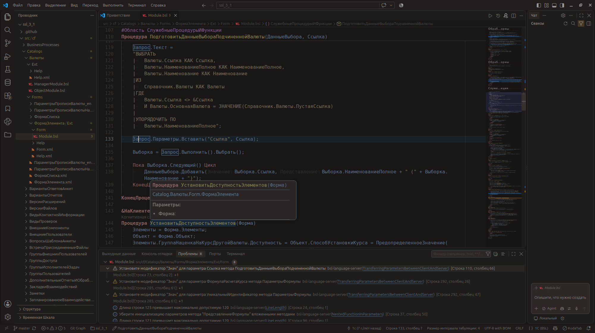
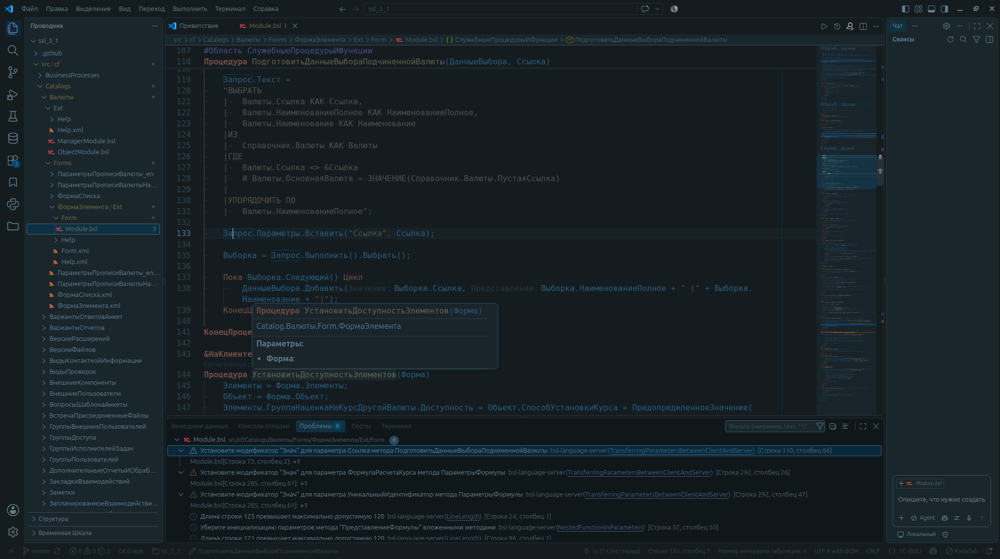
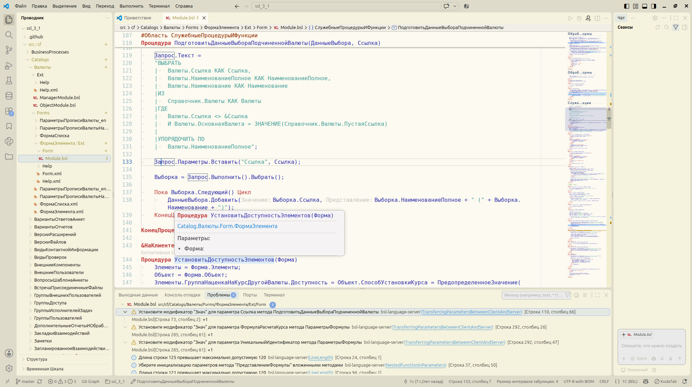
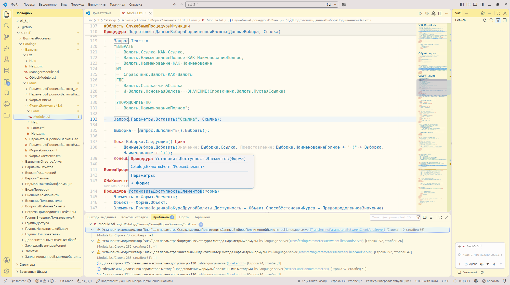

# vscode-onec-theme

[Русский](README.md) | English

OneC Theme is a set of color themes for Visual Studio Code, inspired by the color scheme of the 1C:Enterprise 8 platform. The themes provide a consistent palette for the editor interface and syntax highlighting for code and other file types.

### Additional extensions

Some languages and highlighting features may require additional extensions:

- [Language 1C (BSL)](https://marketplace.visualstudio.com/items?itemName=1c-syntax.language-1c-bsl) provides grammars for BSL and the 1C query language. It also enables highlighting for `1c`, `bsl`, `os`, and `sdbl` code blocks in Markdown files opened in the editor.
- [BSL Language Server](https://github.com/1c-syntax/bsl-language-server) is required for semantic highlighting in BSL. It is off by default in these themes. To enable it, set `editor.semanticHighlighting.enabled` to `true` in Visual Studio Code.
- [1C:Enterprise.Element Script](https://marketplace.visualstudio.com/items?itemName=1c-soft.1c-executor-plugin) or [vscode-xbslplugin](https://github.com/bia-technologies/vscode-xbslplugin) provide grammars for `.sbsl` and `.xbsl` files.
- [Turbo Gherkin support](https://github.com/ChernyakAI/vscode-turbogherkin-support) adds highlighting for Gherkin `.feature` files and `feature` code blocks in Markdown files. The [Cucumber (Gherkin) Full Support](https://marketplace.visualstudio.com/items?itemName=alexkrechik.cucumberautocomplete) extension is also supported.

OneC Theme also styles the built-in Markdown Preview to match the selected theme and highlights code blocks in the editor's color palette, including 1C code, `feature` files, and other supported formats.

## Examples

OneC Dark - a dark theme

OneC Midnight - an alternative dark theme for working in low light

OneC Light - a light theme

OneC Yellow - the collection wouldn't be complete without it.

## Installation

1. Download the VSIX from the [releases page](https://github.com/ChernyakAI/vscode-onec-theme/releases). In the Extensions view, select “Install from VSIX…” and choose the downloaded file.
2. In the Extensions view, search the Marketplace for `OneC Theme` and select “Install”.
